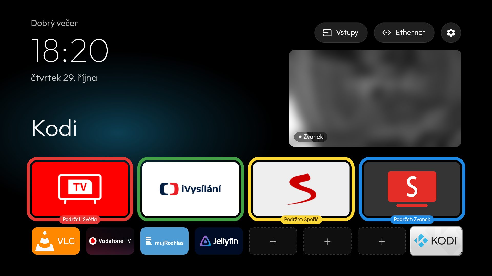
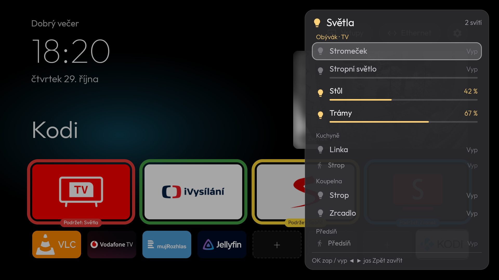
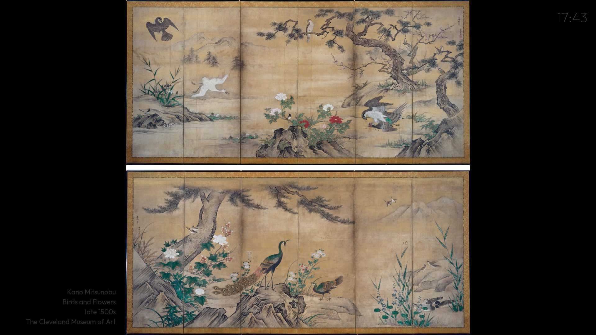

# tv-home-modules

**A modular prompt package for an AI coding assistant (Claude Code or similar) that debloats an
Android TV over ADB and gives it a clean, Apple-TV-style Home screen.** Optional modules add
an art screen saver, a video doorbell, and a Home Assistant lights panel, all driven from the
colour buttons on the remote.

The repo holds the prompts, the launcher source and the helper scripts. No APKs: the assistant
builds the launcher on your computer and installs it over ADB, verifying each step with
screenshots from the TV.

> **Based on [cleanyourtv](https://github.com/Gathin23/cleanyourtv) by Gathin (MIT).**
> The base module keeps the structure and safety rules of its
> [PROMPT.md](https://github.com/Gathin23/cleanyourtv/blob/main/PROMPT.md) and folds in its later
> improvements. The Home screen design and the three add-on modules are new. If you only want a
> debloat and a simple Home, use cleanyourtv: it supports more TVs, has device examples, and an
> add-on system of its own. See [Credits](#credits).

## Modules

| Module | Prompt | Adds | Needs |
|---|---|---|---|
| **00 Base** | [`prompts/00-base.md`](prompts/00-base.md) | Backup, debloat, the new launcher as Home, restore script, ADB closed at the end | An Android TV / Google TV with developer options |
| **10 Screen saver** | [`prompts/10-screensaver.md`](prompts/10-screensaver.md) | Public-domain paintings from The Met, Cleveland and the Art Institute of Chicago; dim clock; standby after 60 min; **hold Yellow** to start | Base |
| **20 Doorbell** | [`prompts/20-doorbell.md`](prompts/20-doorbell.md) | Live doorbell tile on Home, 4K full screen, **ring → full screen** (also from standby), **person → picture-in-picture**, **hold Blue** | Base, an RTSP + ONVIF doorbell (tested with Reolink); Home Assistant optional |
| **30 Home Assistant** | [`prompts/30-home-assistant.md`](prompts/30-home-assistant.md) | Lights panel over any app, ordered by room and floor from the TV outward; toggle and dim from the remote; **hold Red** | Base, Home Assistant with a long-lived token |

All features live in **one launcher APK**. A module is the part of the prompt that configures,
verifies and documents a feature. Features you don't set up stay off: no doorbell URL means no
tile, no HA token means no panel, and the screen saver is only used if you select it.

## What it looks like



*The test TV runs in Czech; the launcher ships English strings too. The doorbell picture is
blurred for privacy.*

- **Row 1:** the red, green, yellow and blue rings. A short press of that colour on Home opens
  the app, and the pill on the ring names what holding the button does.
- **Row 2:** eight small slots; "+" adds an app. Below: all other apps, four columns.

- **Look:** pitch black (or your wallpaper), the Outfit typeface, no blur. One glass highlight
  springs from tile to tile, and the focused tile grows a little and shows its name.
- **Clock:** greeting, clock and date top left, refreshed every time Home is shown (also
  after standby).
- **Pills** top right: **Inputs** (Live TV, HDMI, AV), the network name, Settings.

## Using it on the TV

### Home and dock

| Action | Result |
|---|---|
| Colour button, **short press, on Home** | Opens the app in that ring (row 1). Elsewhere the colour buttons keep their normal job (HbbTV, teletext) |
| **OK** on a **"+"** slot | The app grid opens in pick mode; choose an app (Back cancels) |
| **Hold OK** on a dock app | *Replace app / Remove from dock / Cancel* (Cancel is focused) |
| **Down** from the dock | All other apps |
| **Back** | Back to the dock |
| **Home** on Home | Back to row 1 |

Dock edits are saved on the TV.

### Colour buttons held for about 1 s, from any app

Needs the accessibility service **Home: colour buttons** (Settings → Device Preferences →
Accessibility). Short presses are never affected.

| Hold | Does | Module | Setting (`0` = off) |
|---|---|---|---|
| **Red** | Lights panel; ▲▼ choose, OK on/off, ◀ ▶ dim, Back closes, hides itself after 30 s. Over the screen saver it doesn't end it | 30 | `ha_hold_key=183` |
| **Yellow** | Start the screen saver now; any *new* press ends it | 10 | `screensaver_hold_key=185` |
| **Blue** | Doorbell full screen on/off | 20 | `doorbell_hold_key=186` |

The pill on each ring's bottom edge shows what holding that button does.



### Doorbell (module 20)

| Trigger | What happens |
|---|---|
| **Ring** | Full screen in 4K, media paused. Closes after 60 s without activity and resumes the media, or puts the TV back into standby if the ring woke it |
| **Person** | Small live picture bottom-right over any app; closes 10 s after the last event |
| Motion, pet, vehicle | The Home tile's border flashes (amber = person, white = other); no other action by default |
| **OK** on the Home tile, or **hold Blue** | Full screen |

Events come straight from the doorbell (ONVIF) **and** from Home Assistant as a backup,
deduplicated. Each event's action is configurable (`on_ring`, `on_person`, … = `doorbell`, `pip`,
`none`).

### Screen saver (module 10)



Paintings up to 1910 (about 365 works), fitted to the screen height and changed every
5–15 min. A faint caption sits in the black band beside the painting (or in a strip under a
wide one, never over it), with a tiny dim clock on the opposite side. Each painting is downloaded once and stored on the
TV at screen size (about 200 MB for all), the next one in advance, so it works offline from
what is stored. It puts the TV into standby after 60 min.

## Getting started

1. **On the TV:** Settings → Device Preferences → About → press OK on **Build** 7 times. Then
   Developer options → **USB debugging** (and network debugging, if offered) on.
2. **On your computer** (same network as the TV):
   - Python 3.9+, git, and [Claude Code](https://claude.com/claude-code) or another assistant
     with shell access.
   - The assistant will offer to fetch Google's platform-tools (adb), and for the launcher JDK
     17+, the Android SDK and Gradle 8.9. It asks before downloading anything.
3. Clone and open the folder in the assistant:

   ```bash
   git clone https://github.com/zdar/tv-home-modules.git
   ```

4. Paste the part of [`prompts/00-base.md`](prompts/00-base.md) below its line, with your TV
   model and IP filled in. Add the module prompts you want under it in the same message, or run
   them later one at a time.
5. Answer the checklist questions (which apps you use, the dock, keep the voice assistant or
   Chromecast?) and accept the *Allow USB debugging?* prompt on the TV.
6. Some steps are yours, and the assistant asks you to do them:
   - **Settings that change security:** switching on the accessibility service and selecting
     the screen saver.
   - **Passwords and tokens:** the scripts ask for them in your terminal and write them only to
     the TV, never to the repo or the chat.
   - **Real-remote tests:** held buttons, ringing the doorbell.
7. At the end, the assistant switches network ADB off and checks that port 5555 is closed.

## Settings

Everything can be changed without rebuilding: in
`/sdcard/Android/data/io.github.tvhomemodules.launcher/files/launcher.properties` on the TV,
which is read on every return to Home. Every key is listed with its default in
[`examples/launcher.properties.example`](examples/launcher.properties.example), and the launcher
writes the same template next to the file on the TV.

```bash
python tools/tv.py --adb pull /sdcard/Android/data/io.github.tvhomemodules.launcher/files/launcher.properties
```

```bash
python tools/tv.py --adb push launcher.properties /sdcard/Android/data/io.github.tvhomemodules.launcher/files/
```

- Edit the file pulled from the TV, not the template: it holds your doorbell login and HA
  token. Never commit it (`.gitignore` excludes it).
- `wallpaper=wallpaper.jpg` plus `push wallpaper.jpg` into the same folder puts a picture
  behind Home.
- The built-in defaults are in `launcher/app/src/main/res/values/config.xml`.

## Scripts

All take `TV_HOST=<ip>` (and `TV_PORT`, default 5555).

| Script | What it does |
|---|---|
| `build_and_install.py` | Build the debug APK (in `BUILD_DIR`) and install it. `--set-home` makes it Home, `--no-build` reinstalls, `--build-only` |
| `restore.py <pkg>…` | Re-enable packages. `--launcher` undoes everything: re-enables all logged packages, restores the stock Home and removes this launcher. `--dns` resets Private DNS |
| `tools/tv.py` | Run a shell command on the TV. `--screenshot shots/x.png`, `--key DPAD_DOWN …`, `--adb <args>` |
| `tools/disable.py <pkg>…` | Disable packages one by one, logged to `backup/disabled-by-us.txt`; refuses Android core packages |
| `tools/whatis.py <pkg>…` | Show a package's components and permissions **without starting it** |
| `tools/scan_key.py clear` / `read <name>` | Find the scancode and keycode of a remote button |
| `tools/monitor.py [s]` | Passive long-run log (awake, dreaming, front app, launcher log lines) to `shots/monitor.log` |
| `tools/set_doorbell.py` | Store the doorbell RTSP login on the TV (`DOORBELL_HOST`), `--off` removes it |
| `tools/setup_events.py` | Doorbell events from Home Assistant: token on the TV and HA YAML printed (`TV_MAC` for Wake-on-LAN), `--show` |
| `tools/ha_lights.py` | List your HA lights (names, floors, rooms, labels, brightness support) into `shots/ha_lights.txt` for the panel mockup (`HA_URL`) |
| `tools/set_ha.py` | Store the HA URL and token on the TV for the lights panel, `--off` |
| `tools/adb-closed.py <ip>` | Check that network ADB is closed (only "refused" counts) |

## Undo

```bash
python restore.py com.google.android.youtube.tv
```

```bash
python restore.py --launcher
```

The first command re-enables one app. The second re-enables everything that was disabled,
makes the stock launcher Home again and uninstalls this launcher; reboot afterwards. Nothing is
ever uninstalled from the system.

## Privacy and security

- **No telemetry**, no accounts, no cloud. The launcher talks only to:
  - your doorbell and Home Assistant, on your LAN;
  - the museum APIs, while the screen saver runs.
- **Credentials:** the doorbell login and the HA token are stored only in the launcher's
  settings file on the TV. The helper scripts take them through `getpass`, so they never appear
  in the chat or the repo.
- **The event listener** (port 8765, module 20) accepts only requests carrying the token that
  `setup_events.py` generated.
- **The accessibility service** reacts only to held colour buttons and draws the overlays. It
  doesn't read screen content.
- **ADB:** network ADB is switched off at the end, because port 5555 is unencrypted.

## Tested on, and known issues

Tested on a TCL BeyondTV2 (Android TV 9, 4K, 2 GB) with a Reolink doorbell and Home Assistant.
The prompts carry the general rules from cleanyourtv for other brands, but the modules haven't
been tried elsewhere. Firmware quirks, Windows build notes and open issues, including
rendering cost, key repeats, PiP over video and Wake-on-LAN, are in
[`docs/NOTES.md`](docs/NOTES.md).

Won't work on Samsung Tizen, LG webOS or Fire TV.

## Repository layout

```
prompts/        00-base.md, 10-screensaver.md, 20-doorbell.md, 30-home-assistant.md
launcher/       Android launcher source (Java, minSdk 26): Home, key helper, doorbell, screen saver, HA panel
tools/          ADB and setup helpers (Python 3, no dependencies)
examples/       launcher.properties.example, a TCL BeyondTV2 debloat list
docs/NOTES.md   tested device, lessons, known issues
build_and_install.py, restore.py
```

The scripts create `backup/`, `shots/` and `apks/`, which are per TV and git-ignored.

## Credits

- **[cleanyourtv](https://github.com/Gathin23/cleanyourtv)** by **Gathin**, MIT: the original
  prompt, the debloat and ADB safety rules, the Apple-TV-style Home concept and the device
  notes this project relies on, including the BeyondTV2 rendering notes and the Frigate Glance
  PiP finding. Thank you!
- **[Outfit](https://github.com/Outfitio/Outfit-Fonts)** typeface, SIL Open Font License 1.1
  (`launcher/OFL-Outfit.txt`).
- **Artworks** from the open-access programmes of
  [The Metropolitan Museum of Art](https://metmuseum.github.io/),
  [Cleveland Museum of Art](https://openaccess-api.clevelandart.org/) and the
  [Art Institute of Chicago](https://api.artic.edu/docs/), public domain or CC0. They are fetched
  at run time, and none is included here.
- **Libraries:** AndroidX, Media3 ExoPlayer (Apache 2.0), OkHttp (Apache 2.0).
- Made by [zdar](https://github.com/zdar) with Claude Code.

## License

MIT, see [LICENSE](LICENSE). Not affiliated with TCL, Google, Reolink, Home Assistant or any
museum.
